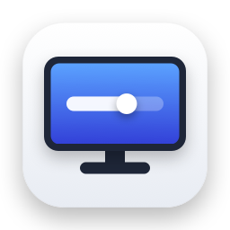
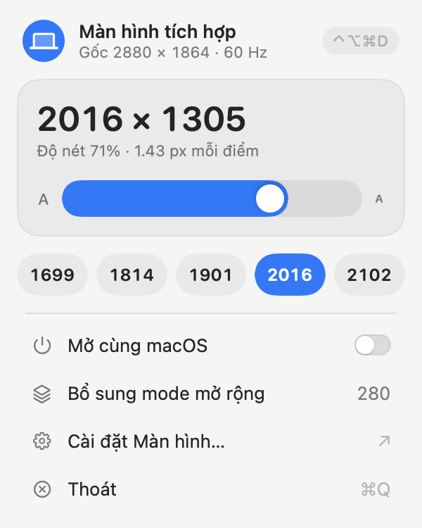
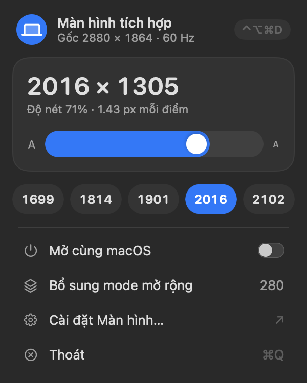

<div align="center">



# DisplayLab

**A tiny, native, offline menu bar app for sharp HiDPI scaling on macOS.**

Pick exactly how much space your Mac's display shows — beyond the few sizes System Settings offers —
using only macOS's own display mechanisms. No license key, no network, no background helper.

[Download](https://github.com/luusytruong/DisplayLab/releases/latest) · [Build from source](#build-from-source) · [How it works](#how-it-works)

</div>

<p align="center">
  
  &nbsp;&nbsp;
  
</p>

## Features

- **Smooth scaling** — a Control Center–style slider over every HiDPI "looks like" size, plus five quick-pick sizes.
- **Sharpness readout** — shows the real panel pixels per UI point (2.00 = Retina 2x, pixel-perfect), so you can see how much sharpness each size costs.
- **Extended modes** — writes extra HiDPI sizes into macOS's own display override file (one admin prompt the first time).
- **Built-in and external displays** — HiDPI where available, 1x otherwise; sizes that don't fill a notched panel are filtered out.
- **Menu bar panel that behaves** — opens on mouse-down, closes when focus leaves or the Space changes, re-anchors under the icon after a resolution change.
- **Global shortcut ⌃⌥⌘D** — opens the panel even when the icon is hidden behind the notch.
- **Launch at login**, light/dark mode, ~850 lines of Swift, universal binary (Apple Silicon + Intel).

> The interface is currently in Vietnamese. Translations are welcome.

## Requirements

macOS 14 Sonoma or later.

## Install

1. Download `DisplayLab-<version>.dmg` from [Releases](https://github.com/luusytruong/DisplayLab/releases/latest) and drag **DisplayLab** to **Applications**.
2. The app is **not notarized** (no paid Apple Developer ID), so the first launch is blocked by Gatekeeper. Either:
   - open it once, then go to **System Settings → Privacy & Security**, click **Open Anyway** and confirm; or
   - run in Terminal:
     ```sh
     xattr -dr com.apple.quarantine /Applications/DisplayLab.app
     ```
3. Click the display icon in the menu bar, or press **⌃⌥⌘D**.

Tip: if the icon is hidden behind the notch, ⌘-drag it to the right, next to the clock. DisplayLab remembers the position.

## How it works

DisplayLab uses only public macOS APIs and the system's own display override files — no private frameworks, no SIP changes, no virtual displays:

| Task | Mechanism |
|---|---|
| List display modes | `CGDisplayCopyAllDisplayModes` |
| Switch mode (remembered across reboots) | `CGConfigureDisplayWithDisplayMode` + `CGCompleteDisplayConfiguration(.permanently)` |
| Add more HiDPI sizes | `scale-resolutions` entries in `/Library/Displays/Contents/Resources/Overrides/DisplayVendorID-<vid>/DisplayProductID-<pid>` |

Each `scale-resolutions` entry is the backing size (2× the "looks like" size) as two big-endian 32-bit integers. macOS reads the file when the display is enumerated, so newly added sizes appear after you log out, restart, or reconnect the display.

**Sharpness:** on a panel `N` pixels wide, a "looks like" width `W` gets `N / W` physical pixels per point. Only `W = N / 2` is pixel-perfect; every other size is rendered at 2× and resampled, and text gets fewer real pixels as `W` grows.

## Build from source

Only the Xcode Command Line Tools are needed (`xcode-select --install`).

```sh
git clone https://github.com/luusytruong/DisplayLab.git
cd DisplayLab
./build.sh            # → build/DisplayLab.app (universal, ad-hoc signed)
./build.sh --install  # also copies to /Applications and launches it
scripts/package.sh    # → dist/DisplayLab-<version>.dmg, .zip and SHA256SUMS.txt
```

The icon is drawn in code: `swift scripts/make-icon.swift AppIcon.iconset && iconutil -c icns AppIcon.iconset -o AppIcon.icns`.

## Uninstall

Quit DisplayLab and delete it from Applications. The extra display sizes live in the macOS override file above;
to remove them too (restores macOS's default size list after a restart):

```sh
sudo rm /Library/Displays/Contents/Resources/Overrides/DisplayVendorID-<vid>/DisplayProductID-<pid>
```

Back the file up first if another tool (e.g. BetterDisplay) created it.

## Acknowledgments

The override-plist approach is the same one used by [BetterDisplay](https://github.com/waydabber/BetterDisplay) and
[Crisp](https://github.com/didriksg/Crisp) (MIT), which were helpful references.

## License

[MIT](LICENSE)

---

### Tiếng Việt

DisplayLab là app menu bar nhỏ, chạy offline, giúp chỉnh độ phân giải HiDPI cho màn hình Mac mịn hơn các mức có sẵn
trong System Settings, chỉ dùng cơ chế gốc của macOS. Tải bản cài ở mục [Releases](https://github.com/luusytruong/DisplayLab/releases/latest).
App chưa được Apple notarize nên lần đầu mở cần vào **System Settings → Privacy & Security → Open Anyway**,
hoặc chạy `xattr -dr com.apple.quarantine /Applications/DisplayLab.app`.
